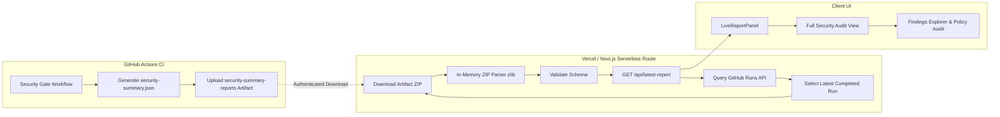

# PipelineShield Security Dashboard

Production-grade Next.js DevSecOps Security Gate dashboard. PipelineShield provides an executive, light editorial security evaluation reporting interface that automatically ingests and displays authoritative CI telemetry directly from GitHub Actions workflow runs.

---

## Architecture Overview



### Key Technical Guarantees
- **No Database Overhead**: GitHub Actions artifact storage acts as the authoritative report ledger.
- **Server-Side Token Isolation**: `GITHUB_TOKEN` is used strictly within server-side Route Handlers and is never leaked to client components or browser JavaScript.
- **Pure In-Memory ZIP Extraction**: Uses Node.js built-in `zlib` and `Buffer` without filesystem writes, eliminating Zip Slip vulnerabilities.
- **Security Limits**: 10MB maximum archive cap, 5MB uncompressed limit (zip bomb defense), and 10s request timeouts.
- **Authoritative Provenance**: Strictly distinguishes live GitHub CI reports from user-uploaded JSON artifacts and static demonstration datasets.

---

## Environment Configuration

### Required Variables

| Variable | Required | Description | Example |
| :--- | :---: | :--- | :--- |
| `GITHUB_TOKEN` | Yes | Fine-grained or personal access token with read permissions | `github_pat_...` |
| `GITHUB_REPOSITORY` | Optional | Target GitHub repository (`owner/repo`). Defaults to `RishvinReddy/PipelineShield` | `RishvinReddy/PipelineShield` |

### Required Token Permissions
Configure a **Fine-Grained Personal Access Token** in GitHub Settings:
1. **Repository Access**: Select *Only select repositories* -> `RishvinReddy/PipelineShield`.
2. **Repository Permissions**:
   - `Actions`: **Read-Only** (required to list workflow runs and download artifact ZIPs).
   - `Metadata`: **Read-Only** (automatically included for repository metadata).
3. **Restricted Privileges**: DO NOT grant `Administration`, `Contents` (write), `Workflows` (write), or `Secrets` permissions.

---

## Local Development Setup

1. **Clone and enter dashboard directory**:
   ```bash
   cd dashboard
   ```

2. **Configure local environment**:
   ```bash
   cp .env.example .env.local
   ```
   Edit `.env.local` and add your read-only `GITHUB_TOKEN`:
   ```bash
   GITHUB_TOKEN=github_pat_your_token_here
   GITHUB_REPOSITORY=RishvinReddy/PipelineShield
   ```

3. **Install dependencies**:
   ```bash
   npm install
   ```

4. **Start local development server**:
   ```bash
   npm run dev
   ```
   Open [http://localhost:3000](http://localhost:3000) to view the live dashboard.

---

## Vercel Deployment Configuration

When deploying the Next.js application to Vercel:

1. Connect the `RishvinReddy/PipelineShield` repository in Vercel.
2. In **Project Settings** -> **Environment Variables**, configure:
   - `GITHUB_TOKEN`: Your fine-grained read-only GitHub token.
   - `GITHUB_REPOSITORY`: `RishvinReddy/PipelineShield`.
3. Set **Framework Preset** to `Next.js`.
4. Deploy the project. The dashboard will automatically fetch live CI runs upon visit.

---

## API Contract: `GET /api/latest-report`

### Success Response (`200 OK`)
```json
{
  "success": true,
  "report": {
    "decision": "PASS",
    "reasons": ["Zero blocking violations detected"],
    "summary": {
      "total_findings": 0,
      "critical": 0,
      "high": 0,
      "medium": 0,
      "low": 0,
      "info": 0,
      "exempted": 0,
      "blocking_count": 0,
      "warning_count": 0
    },
    "blocking_findings": [],
    "warning_findings": [],
    "advisory_findings": [],
    "exempted_findings": [],
    "evaluated_at": "2026-10-30T17:15:00Z",
    "scanner_status": {
      "trivy": "COMPLETED",
      "semgrep": "COMPLETED",
      "dependency_review": "COMPLETED"
    },
    "policy_metadata": {
      "name": "PipelineShield Default Security Policy",
      "repository": "RishvinReddy/PipelineShield",
      "branch": "main",
      "commit": "ca17407"
    }
  },
  "run": {
    "id": 41109686001,
    "name": "DevSecOps Policy Enforcement Gate",
    "status": "completed",
    "conclusion": "success",
    "html_url": "https://github.com/RishvinReddy/PipelineShield/actions/runs/41109686001",
    "head_sha": "ca17407",
    "head_branch": "main",
    "event": "push",
    "created_at": "2026-10-30T17:10:00Z",
    "updated_at": "2026-10-30T17:15:00Z"
  },
  "artifact": {
    "id": 12345678,
    "name": "security-summary-reports",
    "size_in_bytes": 10240,
    "expired": false,
    "created_at": "2026-10-30T17:15:10Z"
  },
  "fetched_at": "2026-10-31T01:00:00.000Z"
}
```

### Error Responses
- `401 Unauthorized`: Missing or invalid `GITHUB_TOKEN`.
- `403 Forbidden` / `429 Too Many Requests`: GitHub rate limit reached or token lacks permissions.
- `404 Not Found`: Repository not found or no eligible completed run/artifact exists.
- `410 Gone`: The GitHub artifact has expired (retention window exceeded).
- `413 Payload Too Large`: Artifact exceeds the 10MB safety threshold.
- `502 Bad Gateway`: GitHub upstream error, malformed ZIP, or invalid schema.
- `504 Gateway Timeout`: GitHub API request exceeded the 10-second timeout.

---

## Testing & Quality Verification

Run all test suites locally:
```bash
# Run both live ingestion unit tests and dashboard contract tests:
npm run test

# Run live ingestion tests individually:
npm run test:ingestion

# Run shared report contract tests:
npm run test:contract

# Run ESLint:
npm run lint

# Run Next.js production build:
npm run build
```

---

## Troubleshooting

| Symptom | Probable Cause | Resolution |
| :--- | :--- | :--- |
| `Live Ingestion Telemetry Unavailable: GITHUB_TOKEN environment variable is not configured` | Missing `.env.local` or token on Vercel | Add `GITHUB_TOKEN` to `.env.local` or Vercel Environment Variables. |
| `GitHub API rate limit exceeded (429)` | Running without a token or unauthenticated rate limit reached | Provide a valid personal access token in `GITHUB_TOKEN` (5,000 req/hr quota). |
| `Artifact ... has expired on GitHub (410)` | GitHub artifact retention expired (default 90 days) | Trigger a fresh run of the `security-gate` workflow on GitHub Actions. |
| `Run #... does not contain artifact 'security-summary-reports'` | Run failed before artifact upload step or workflow was cancelled | Ensure workflow uploaded `security-summary-reports` with `if: always()`. |
| Dashboard falls back to demo mode | Backend ingestion failed or token is missing | Ingestion gracefully falls back to synthetic test fixtures so dashboard never crashes. |
